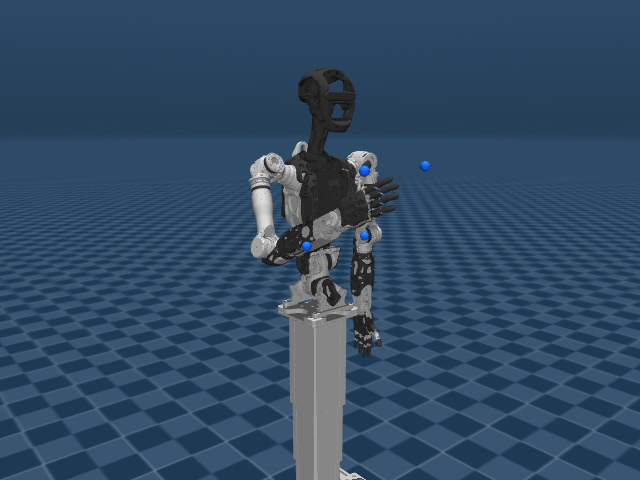
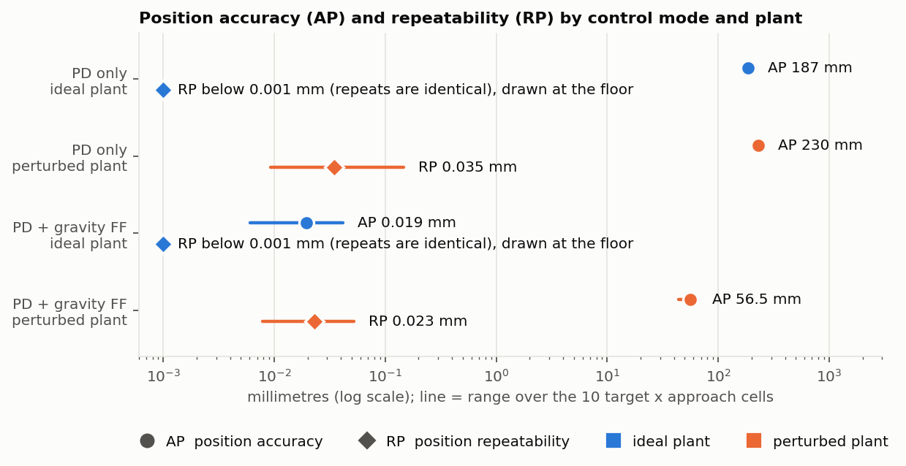

# ADAM-U end-effector accuracy and repeatability in MuJoCo

A test procedure that measures how accurately and how repeatably the PNDbotics
ADAM-U upper-body humanoid places its right hand, run in simulation on the
official model. This is step 5 of the REVEL Robotics interview task; the
proposal for steps 1 to 4 is a separate PDF.



The robot is commanded through the same joint law as the vendor SDK, with the
vendor's example gains. The hand is sent to five targets from two opposite
approach directions, ten times each, with and without gravity feed-forward, on
an ideal plant and on a plant with four injected real-robot effects.
That is 400 trials. A second run of 250 trials switches the effects on one at
a time.

## Results

All numbers below come from `results/` and are reproduced by the commands in
[Run it](#run-it). The full tables are in [`results/report.md`](results/report.md).

| Control | Plant | Accuracy AP (mm) | Repeatability RP (mm) | Approach difference vAP (mm) |
|---|---|---|---|---|
| PD only (vendor example as shipped) | ideal | 187 (166 to 207) | 0 | 0.01 |
| PD only | perturbed | 230 (199 to 256) | 0.035 (max 0.15) | 17 |
| PD + gravity feed-forward | ideal | 0.02 (max 0.04) | 0 | 0.03 |
| PD + gravity feed-forward | perturbed | 56 (44 to 66) | 0.023 (max 0.05) | 24 |

AP is the distance from the target to the mean reached position, RP is the
ISO 9283 repeatability (mean radius plus three standard deviations), both per
target and approach. vAP is the largest distance between the mean positions of
the two approaches.

The same trials summarised the classic way, as statistics of the per-trial
distance from the target:

| Control | Plant | Mean error (mm) | Spread 1 SD (mm) | RMSE (mm) | Worst (mm) | Success rate |
|---|---|---|---|---|---|---|
| PD only | ideal | 186.84 | 18.06 | 187.70 | 206.54 | 0 % |
| PD only | perturbed | 230.23 | 21.57 | 231.23 | 255.55 | 0 % |
| PD + gravity FF | ideal | 0.019 | 0.012 | 0.023 | 0.042 | 100 % |
| PD + gravity FF | perturbed | 56.48 | 6.99 | 56.91 | 65.67 | 0 % |

Mean error and AP come out equal here to within a millionth of a millimetre. That is not a
coincidence and not a bug: the two can only coincide when the repeats of a cell
land on top of each other, which is what the near-zero RP says. All of the error
is systematic bias, none of it is scatter. Section 2.3 of
[`results/report.md`](results/report.md) explains why both sets of metrics are
kept and where they disagree.



### How the results were reached

**1. Found.** Commanding the arm exactly as the vendor example does (PD only),
the hand stops 166 to 207 mm from the target, mostly straight down. The error
is the same on every repeat, so it is a bias and not scatter.

**2. Diagnosed.** Each joint settles where its PD torque balances gravity, so
its error is gravity torque divided by stiffness. The elbow has kp = 9 N·m/rad
and carries 3.6 N·m at P1, so it sags about 24 degrees and alone moves the hand
151 mm of the 187 mm (figure 4 in the report). A static calculation that solves
this torque balance without simulating predicts the same error within 0.06 mm.

**3. Improved.** Two options were measured.

- *Gravity feed-forward*, using the torque field the SDK already offers and the
  same gains: the error falls from 187 mm to 0.02 mm on the ideal plant.
- *Stiffer gains* on the five soft joints, without feed-forward: a 20-fold
  increase (kp 9 to 180) reduces the error only from 187 to 38 mm, because the
  joints that were not changed still sag (figure 7, a what-if measurement, not a
  tuning proposal).

Feed-forward is therefore the effective fix. Stiffness helps with whatever
feed-forward cannot cancel.

**4. Stress-tested.** The improved controller was run on a plant with four
real-robot effects.

- The error returns to 56 mm, and the hand comes back to that same wrong place
  within about 0.05 mm. A repeatability test alone would call this robot
  excellent.
- A 0.3 kg payload that the controller does not know about causes 55 mm of it.
- Joint friction makes the result depend on the approach direction: reached
  from opposite sides the hand ends 18 to 24 mm apart, while repeats from one
  side agree within about 0.05 mm. A single approach direction cannot see this.
- Encoder zero offsets of 0.1 to 0.2 degrees cost 0.9 to 1.7 mm, fully
  repeatable, so they are a calibration matter. Encoder noise and a varying
  start pose contribute about 0.01 mm.
- With stiffer soft joints (kp 180) the same perturbed plant ends 8 mm from the
  target instead of 56 mm.

Error sources one at a time (PD + gravity feed-forward, 50 trials each):

| Error source | AP mean (mm) | RP mean (mm) | vAP max (mm) |
|---|---|---|---|
| start-pose jitter only | 0.02 | 0.0001 | 0.03 |
| encoder noise | 0.02 | 0.012 | 0.04 |
| encoder zero offset | 1.3 | 0.0001 | 0.03 |
| joint friction | 10.6 | 0.009 | 24 |
| 0.3 kg unknown payload | 55.5 | 0.0002 | 0.07 |

These are simulation results with the vendor's example gains and assumed error
magnitudes. They are not a statement about a physical ADAM-U. See
[Limits](#limits).

Every metric has a table in [`results/report.md`](results/report.md) and a figure in `results/plots/`:

| Figure | Shows |
|---|---|
| `fig1_accuracy_vs_repeatability` | AP and RP per control mode and plant |
| `fig2_commanded_vs_reached` | commanded and reached TCP positions |
| `fig3_approach_clusters` | every trial's error, by approach direction (vAP) |
| `fig4_error_by_joint` | which joint the error comes from |
| `fig5_error_sources` | error sources one at a time |
| `fig6_settling` | settling during the dwell |
| `fig7_gain_sensitivity` | error against joint stiffness |
| `fig8_error_distributions` | per-trial position and orientation error, median and 95th percentile |
| `fig9_operational` | stabilisation time and peak torque of every trial |
| `fig10_repeatability_spread` | SD along x, y, z, 95 % radius and RP per cell |

## How the test works

| Step | What happens | Where |
|---|---|---|
| Model | The vendored MJCF is patched in memory: free joint removed (fixed base), TCP site added to the right wrist, optional payload. Nothing in `pnd_mujoco` is edited. | `src/model_builder.py` |
| Targets | Five positions in a 250 mm cube: the centre and four corners of a diagonal plane (ISO 9283 layout), one orientation. Each is converted once to a joint command by inverse kinematics. | `src/experiment.py`, `src/kinematics.py` |
| Control | `tau = tau_ff + kp (q_cmd - q) - kd dq` on all 19 motors, the law of the vendor SDK bridge, with the gains of `adam_U_open_arm.py`. Mode `pd`: `tau_ff = 0`. Mode `pd_gff`: `tau_ff` is the gravity torque at the commanded pose. | `src/controller.py` |
| Trial | Reset to `q_cmd ± offset`, hold 1 s, minimum-jerk move 2 s, dwell 4 s, read the TCP pose from the simulator. | `src/trial.py` |
| Plant | Ideal, or with encoder zero offsets, unknown payload, joint friction, encoder noise and start-pose jitter. | `src/perturbations.py`, `config/experiment.yaml` |
| Metrics | ISO-style AP, RP, vAP; mean error, spread, RMSE, percentiles, worst case, success rate; per-axis SD and 95 % radius of the repeats; orientation error; stabilisation time, peak torque, saturated and not-settled counts; error per joint. | `src/metrics.py`, `src/analysis.py` |

Every number the experiment uses is in [`config/experiment.yaml`](config/experiment.yaml).
The reasons behind each choice are in [`docs/assumptions.md`](docs/assumptions.md).

## Why the test can be trusted

- **Floor.** On the ideal plant with exact feed-forward the procedure reports
  0.02 mm (worst cell 0.04 mm). Errors far above that come from the plant.
- **Known-answer check.** For every condition without friction or noise, the
  end pose is also computed without simulating, by solving the static torque
  balance for the joint angles. Simulation and calculation agree within
  0.06 mm, including the 187 mm sag and the 55 mm payload error.
- **Determinism.** A trial run twice gives bit-identical results, and running
  it alone or inside the shuffled 400-trial sequence gives the same result.
- **Versions and machines.** MuJoCo 3.2.0 and 4.0.1 agree within 0.0002 mm on a
  40-trial run. The full 400-trial experiment was then re-run on a second
  machine (Ubuntu 22.04, MuJoCo 3.17.0) and reproduced every reported figure to
  three decimal places.
- **Friction really holds.** MuJoCo's default joint friction is soft and lets
  the arm creep back to the frictionless position within about 20 s. The
  no-slip solver is enabled for plants with friction; a test fails if it is
  switched off.

`pytest tests/` runs these checks: 18 metric tests with hand-computed values and
12 simulation tests on the real model.

## Run it

Needs Python 3.10 or newer, git, and internet access for the first step.
On Ubuntu, `python3 -m venv` may first need `sudo apt install python3-venv`.

```bash
bash scripts/setup_env.sh              # clone pnd_mujoco at the pinned commit into external/
python3 -m venv .venv && source .venv/bin/activate
pip install -r requirements.txt

PYTEST_DISABLE_PLUGIN_AUTOLOAD=1 python3 -m pytest tests/ -v   # 30 tests, about 17 s
python3 scripts/check_setup.py         # model, gains, targets, static predictions
python3 src/run_experiment.py          # 400 trials, about 4 min  -> results/raw_trials.csv
python3 src/run_experiment.py --ablation   # 250 trials, about 2.5 min -> results/raw_ablation.csv
python3 scripts/gain_sensitivity.py    # 200 trials, about 2 min  -> results/gain_sensitivity.csv
python3 src/analysis.py                # results/summary.json, prints the tables
python3 src/plotting.py                # results/plots/*.png
python3 src/report.py                  # results/report.md
```

`bash scripts/reproduce.sh` runs all of the above in order.

`PYTEST_DISABLE_PLUGIN_AUTOLOAD=1` matters on machines where ROS 2 is sourced:
without it pytest tries to load the ROS `launch_testing` plugin from
`/opt/ros/...` and stops with `ModuleNotFoundError: No module named 'lark'`
before running any test.

Other tools:

```bash
python3 scripts/view_trial.py --mode pd --condition nominal --overlay   # watch a trial: blue ball = target
python3 scripts/view_trial.py --headless --target P3          # same trial, text output only
python3 scripts/check_settling.py                             # is the 4 s dwell long enough?

# side-by-side videos for the presentation (add MUJOCO_GL=egl on a headless machine)
python3 scripts/make_comparison_video.py                      # gravity: PD vs PD + feed-forward
python3 scripts/make_comparison_video.py \
    --left pd_gff:nominal --right pd_gff:perturbed            # the 0.3 kg unknown payload
python3 src/run_experiment.py --smoke                         # 40 trials, quick end-to-end check
```

If `pnd_mujoco` is already on disk, pass `--model-path /path/to/pnd_robots/adam_u/scene.xml`
or set `ADAM_U_SCENE_XML`.

Times are for MuJoCo 4.0.1 on two cores. MuJoCo 3.2.0 gives the same numbers
but runs about five times slower.

## Repository layout

```
config/experiment.yaml     all parameters: gains, protocol, targets, plant conditions, seed
src/model_builder.py       load and patch the ADAM-U model
src/kinematics.py          forward kinematics, gravity torque, inverse kinematics, static equilibrium
src/trajectory.py          minimum-jerk joint motion
src/controller.py          SDK joint law, two control modes, encoder model
src/perturbations.py       plant conditions
src/trial.py               one measurement cycle
src/experiment.py          shared set-up: models, targets, seeds
src/run_experiment.py      run the factorial experiment
src/metrics.py             AP, RP, vAP, mean error, spread, RMSE, percentiles, success rate (numpy only)
src/analysis.py            raw CSV -> summary.json
src/plotting.py            figures
src/report.py              results/report.md
scripts/                   setup, reproduce, checks, viewer, gain sensitivity, comparison videos
tests/                     metric tests and simulation tests
results/                   raw trials, summary, plots, videos, report from the reference run
docs/assumptions.md        every assumption and why
docs/ai_usage.md           how AI tools were used
```

## Limits

- **Simulation, not hardware.** The measuring device is the simulator's ground
  truth. On the robot it would be an external tracker with its own uncertainty.
- **The gains are the vendor's example values.** They are the only gains
  PNDbotics publishes for ADAM-U. Whether the real manipulation stack uses them
  is unknown. Errors scale with 1/kp, so stiffer distal joints would shrink
  every number above.
- **Error magnitudes are assumed.** Payload, friction, offsets and noise were
  chosen as plausible values and are listed in the config. They were not
  identified on a robot.
- **Right arm only, static poses only.** No path accuracy, no left arm, no
  fingers, no lifting-column motion, no backlash, joint elasticity, link-length
  error or thermal drift.
- **ISO 9283 definitions, not ISO 9283 compliance.** Ten cycles and two
  approach directions are used where the standard prescribes thirty and three.
- **The perturbed plant is still creeping at the measurement instant.** With
  friction and encoder noise together the hand moves a further 0.07 to 0.2 mm
  over the next 12 s. All trials are measured at the same instant, so RP is a
  fixed-dwell figure. `scripts/check_settling.py` prints the numbers.

## AI tools

See [`docs/ai_usage.md`](docs/ai_usage.md).
