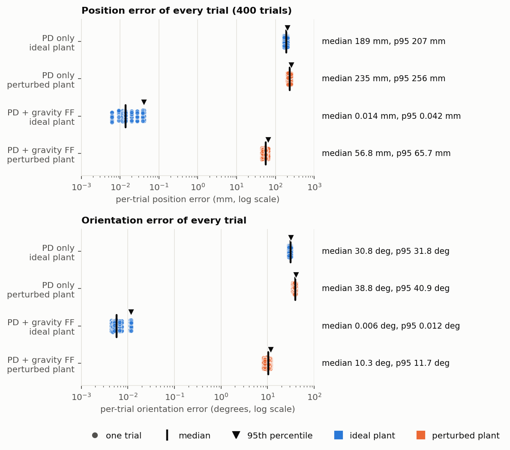
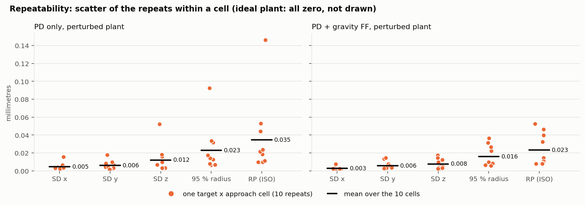
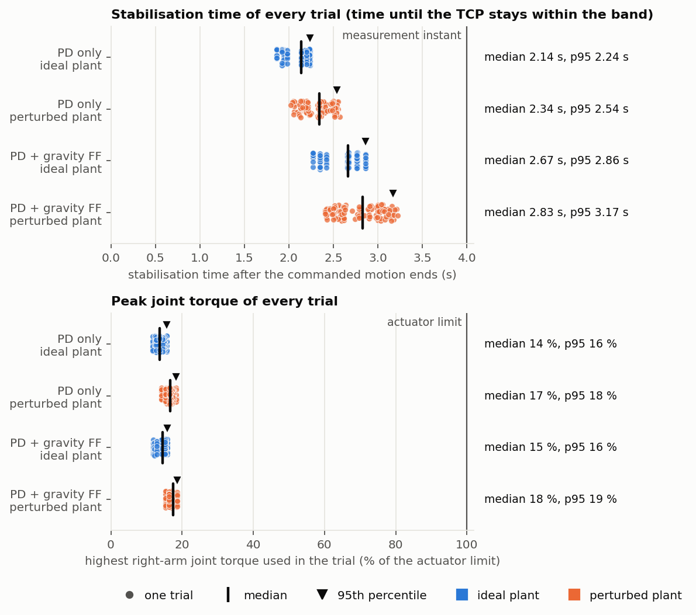
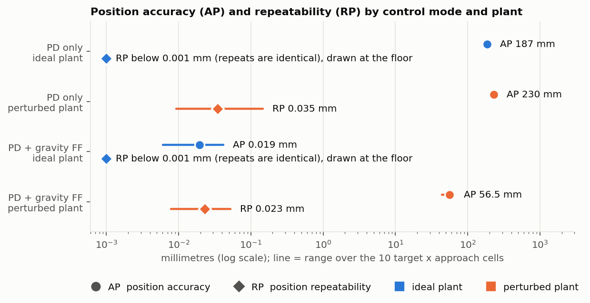
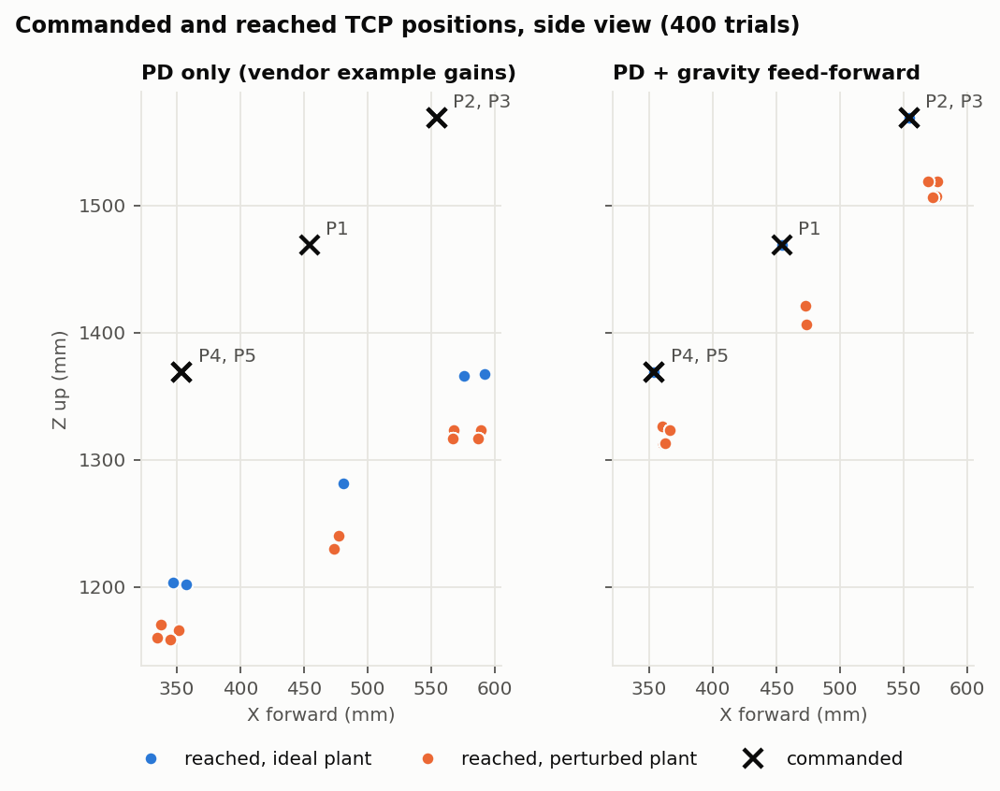
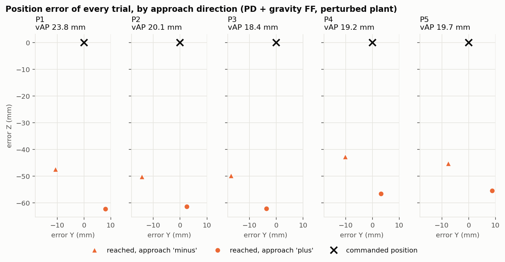
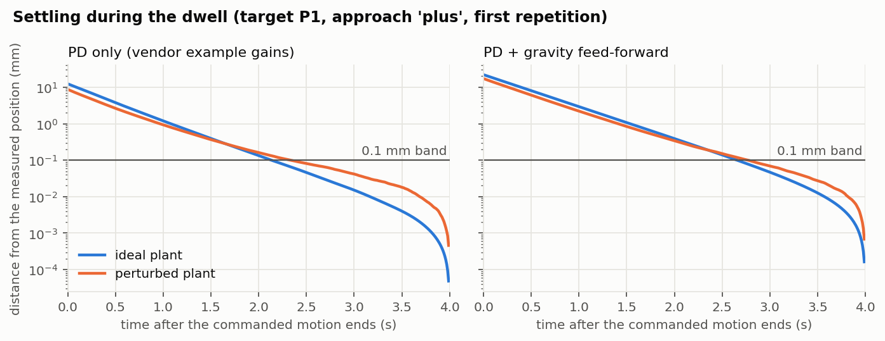
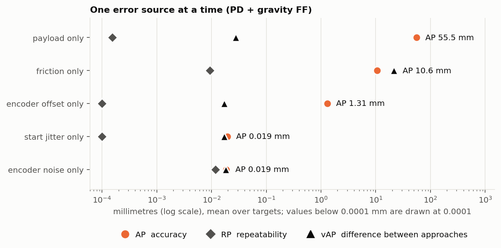
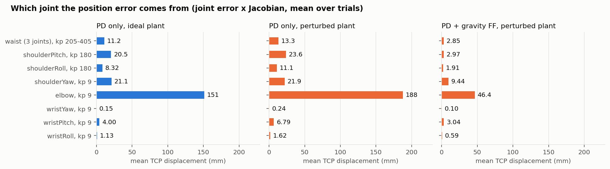
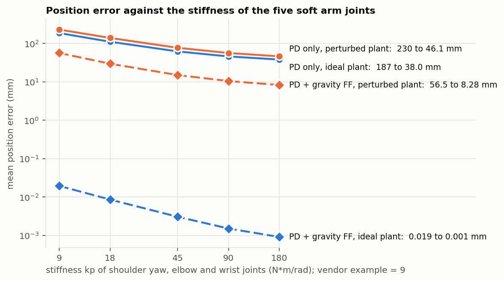

# ADAM-U TCP accuracy and repeatability: results report

_Generated by `src/report.py` from `results/raw_trials.csv` and `results/raw_ablation.csv`. Do not edit by hand; re-run the script._

| Run |  |
|---|---|
| Written | 2026-11-16T14:16:42+01:00 |
| MuJoCo | 3.17.0 |
| pnd_mujoco commit | `84873eb3c4afd584d468864ba41527a1c14fb688` |
| Trials | 400 |
| Seed | 20261114 |
| Simulated time per trial | 7.0 s (1.0 hold + 2.0 move + 4.0 dwell) |

## 1. Definitions

- **AP, position accuracy**: distance from the commanded TCP position to the mean of the reached positions (ISO 9283 definition).
- **RP, position repeatability**: mean distance of the reached positions from their own mean, plus three standard deviations (ISO 9283 definition).
- **vAP**: distance between the mean positions reached from the two approach directions.
- A *cell* is one target reached from one approach direction, 10 repetitions. AP and RP are computed per cell; the tables give their mean and maximum over the 10 cells.
- *Within tolerance* uses 5.0 mm and 2.0 deg, declared in the config for illustration.
- The TCP pose is read from the simulator (ground truth).

## 2. Main experiment

### 2.1 ISO-style metrics

| Control | Plant condition | Trials | AP mean (mm) | AP max (mm) | RP mean (mm) | RP max (mm) | vAP max (mm) | Orientation error mean (deg) | Within tolerance |
|---|---|---|---|---|---|---|---|---|---|
| PD only | nominal | 100 | 186.843 | 206.540 | 0.0000 | 0.0000 | 0.008 | 30.168 | 0 % |
| PD only | perturbed | 100 | 230.233 | 255.527 | 0.0347 | 0.1464 | 17.428 | 38.280 | 0 % |
| PD + gravity FF | nominal | 100 | 0.019 | 0.042 | 0.0000 | 0.0000 | 0.033 | 0.007 | 100 % |
| PD + gravity FF | perturbed | 100 | 56.480 | 65.658 | 0.0231 | 0.0526 | 23.768 | 10.144 | 0 % |

### 2.2 Classic error metrics

The same 400 trials summarised the usual way: statistics of the per-trial distance from the commanded position. These answer a different question from AP and RP -- see section 2.3.

| Control | Plant condition | Trials | Mean error (mm) | Spread, 1 SD (mm) | RMSE (mm) | Worst case (mm) | Success rate |
|---|---|---|---|---|---|---|---|
| PD only | nominal | 100 | 186.843 | 18.0554 | 187.704 | 206.540 | 0 % |
| PD only | perturbed | 100 | 230.233 | 21.5700 | 231.231 | 255.547 | 0 % |
| PD + gravity FF | nominal | 100 | 0.019 | 0.0117 | 0.023 | 0.042 | 100 % |
| PD + gravity FF | perturbed | 100 | 56.480 | 6.9898 | 56.907 | 65.666 | 0 % |

### 2.3 Why both sets are reported

- **Mean error** does not cancel opposing errors, **AP** does. Two trials 5 mm either side of the target give mean error 5 mm and AP 0 mm. Mean error is therefore never smaller than AP, and the gap between them tells you how much of the error is scatter rather than bias.
- **Spread** (standard deviation of the error magnitudes) is not spatial scatter. Points spread over the surface of a sphere centred on the target all have the same error magnitude: spread 0, while **RP** correctly reports them as far apart. RP measures distance from the cluster's own centre in three dimensions; spread measures variation of a single scalar.
- **RMSE** weights outliers more heavily than the mean. With these results the two are close, which is itself informative: the error distribution has no long tail.
- **Success rate** collapses everything to one bit per trial against the declared tolerance (5.0 mm, 2.0 deg). It is the easiest number to quote and the easiest to game by choosing a generous tolerance, so it is reported alongside the others, never alone.


In this run mean error and AP agree to within 6.2e-07 mm (largest gap: PD + gravity FF / perturbed). That is the measurement talking: the two can only coincide when the trials of a cell land on top of each other, which is exactly what the near-zero RP columns say. Every millimetre of error here is systematic bias, not scatter -- so the robot is not imprecise, it is mis-aimed, and the fix is calibration or a better controller model rather than better hardware repeatability.

### 2.4 Distribution, spread, orientation and operation

Per-trial position error (all trials of a group pooled):

| Control | Plant condition | Median (mm) | 90th percentile (mm) | 95th percentile (mm) | Worst (mm) |
|---|---|---|---|---|---|
| PD only | nominal | 189.445 | 206.538 | 206.540 | 206.540 |
| PD only | perturbed | 234.603 | 255.005 | 255.526 | 255.547 |
| PD + gravity FF | nominal | 0.014 | 0.039 | 0.042 | 0.042 |
| PD + gravity FF | perturbed | 56.782 | 65.168 | 65.655 | 65.666 |

Scatter of the repeats inside a cell (mean over the 10 cells; largest cell in brackets):

| Control | Plant condition | SD x (mm) | SD y (mm) | SD z (mm) | 95 % radius (mm) | RP, ISO (mm) |
|---|---|---|---|---|---|---|
| PD only | nominal | 0.0000 (0.0000) | 0.0000 (0.0000) | 0.0000 (0.0000) | 0.0000 (0.0000) | 0.0000 (0.0000) |
| PD only | perturbed | 0.0047 (0.0157) | 0.0060 (0.0178) | 0.0121 (0.0522) | 0.0230 (0.0924) | 0.0347 (0.1464) |
| PD + gravity FF | nominal | 0.0000 (0.0000) | 0.0000 (0.0000) | 0.0000 (0.0000) | 0.0000 (0.0000) | 0.0000 (0.0000) |
| PD + gravity FF | perturbed | 0.0026 (0.0076) | 0.0058 (0.0144) | 0.0077 (0.0176) | 0.0160 (0.0365) | 0.0231 (0.0526) |

Orientation error (angle of the single rotation between commanded and reached orientation):

| Control | Plant condition | Mean (deg) | 95th percentile (deg) | Worst (deg) | Spread between repeats, 1 SD (deg) |
|---|---|---|---|---|---|
| PD only | nominal | 30.168 | 31.821 | 31.821 | 0.0000 (max 0.0000) |
| PD only | perturbed | 38.280 | 40.926 | 40.930 | 0.0020 (max 0.0089) |
| PD + gravity FF | nominal | 0.007 | 0.012 | 0.012 | 0.0000 (max 0.0000) |
| PD + gravity FF | perturbed | 10.144 | 11.746 | 11.748 | 0.0014 (max 0.0029) |

Operation:

| Control | Plant condition | Stabilisation time mean / 95th pct / max (s) | Peak torque mean / max (% of limit) | Saturated trials | Not settled at the measurement | Within 5.0 mm and 2.0 deg |
|---|---|---|---|---|---|---|
| PD only | nominal | 2.08 / 2.24 / 2.24 | 14 / 16 | 0 | 0 | 0 % |
| PD only | perturbed | 2.32 / 2.54 / 2.57 | 16 / 18 | 0 | 0 | 0 % |
| PD + gravity FF | nominal | 2.59 / 2.86 / 2.86 | 14 / 16 | 0 | 0 | 100 % |
| PD + gravity FF | perturbed | 2.81 / 3.17 / 3.22 | 17 / 19 | 0 | 0 | 0 % |

A trial is *not settled* when the TCP was still outside the 0.1 mm band at the end of the dwell. The timing is fixed, so there is no time-out; not settled and saturated are the two ways a trial can be flagged.













### Per target

| Control | Plant condition | Target | AP, approach plus (mm) | AP, approach minus (mm) | RP, plus (mm) | RP, minus (mm) | vAP (mm) |
|---|---|---|---|---|---|---|---|
| PD only | nominal | P1 | 189.445 | 189.445 | 0.0000 | 0.0000 | 0.005 |
| PD only | nominal | P2 | 205.896 | 205.899 | 0.0000 | 0.0000 | 0.008 |
| PD only | nominal | P3 | 206.538 | 206.540 | 0.0000 | 0.0000 | 0.007 |
| PD only | nominal | P4 | 165.521 | 165.520 | 0.0000 | 0.0000 | 0.001 |
| PD only | nominal | P5 | 166.812 | 166.811 | 0.0000 | 0.0000 | 0.002 |
| PD only | perturbed | P1 | 239.192 | 230.017 | 0.0215 | 0.0187 | 17.428 |
| PD only | perturbed | P2 | 255.527 | 250.458 | 0.0441 | 0.0237 | 9.869 |
| PD only | perturbed | P3 | 254.876 | 249.570 | 0.1464 | 0.0529 | 8.588 |
| PD only | perturbed | P4 | 209.401 | 199.366 | 0.0097 | 0.0093 | 16.406 |
| PD only | perturbed | P5 | 210.569 | 203.357 | 0.0113 | 0.0099 | 17.271 |
| PD + gravity FF | nominal | P1 | 0.027 | 0.012 | 0.0000 | 0.0000 | 0.016 |
| PD + gravity FF | nominal | P2 | 0.042 | 0.014 | 0.0000 | 0.0000 | 0.033 |
| PD + gravity FF | nominal | P3 | 0.038 | 0.013 | 0.0000 | 0.0000 | 0.025 |
| PD + gravity FF | nominal | P4 | 0.009 | 0.006 | 0.0000 | 0.0000 | 0.004 |
| PD + gravity FF | nominal | P5 | 0.020 | 0.014 | 0.0000 | 0.0000 | 0.006 |
| PD + gravity FF | perturbed | P1 | 65.658 | 51.974 | 0.0144 | 0.0110 | 23.768 |
| PD + gravity FF | perturbed | P2 | 65.096 | 56.864 | 0.0323 | 0.0526 | 20.145 |
| PD + gravity FF | perturbed | P3 | 64.932 | 54.646 | 0.0398 | 0.0462 | 18.409 |
| PD + gravity FF | perturbed | P4 | 57.132 | 44.289 | 0.0107 | 0.0078 | 19.176 |
| PD + gravity FF | perturbed | P5 | 56.723 | 47.489 | 0.0080 | 0.0087 | 19.668 |




## 3. Checks on the procedure itself

| Check | Result |
|---|---|
| Measurement floor: ideal plant with exact gravity feed-forward | AP mean 0.0195 mm, max 0.0417 mm |
| Determinism: largest RP over all ideal-plant cells | 2.54e-13 mm |
| Simulation minus static prediction, PD only / nominal | mean 0.0293 mm, max 0.0322 mm (prediction itself is 186.815 mm from the target) |
| Simulation minus static prediction, PD only / perturbed | mean 6.9580 mm, max 8.7415 mm (prediction itself is 230.192 mm from the target) |
| Simulation minus static prediction, PD + gravity FF / nominal | mean 0.0195 mm, max 0.0417 mm (prediction itself is 0.000 mm from the target) |
| Simulation minus static prediction, PD + gravity FF / perturbed | mean 10.1174 mm, max 11.9439 mm (prediction itself is 55.907 mm from the target) |
| Simulation minus static prediction, PD + gravity FF / encoder_noise_only | mean 0.0194 mm, max 0.0467 mm (prediction itself is 0.000 mm from the target) |
| Simulation minus static prediction, PD + gravity FF / encoder_offset_only | mean 0.0193 mm, max 0.0413 mm (prediction itself is 1.315 mm from the target) |
| Simulation minus static prediction, PD + gravity FF / friction_only | mean 10.6479 mm, max 12.0063 mm (prediction itself is 0.000 mm from the target) |
| Simulation minus static prediction, PD + gravity FF / payload_only | mean 0.0290 mm, max 0.0523 mm (prediction itself is 55.454 mm from the target) |
| Simulation minus static prediction, PD + gravity FF / start_jitter_only | mean 0.0195 mm, max 0.0417 mm (prediction itself is 0.000 mm from the target) |
| Longest stabilisation time (TCP inside 0.1 mm of its final position) | 3.22 s of a 4.0 s dwell |
| Highest joint torque used | 19 % of the limit; saturated trials: 0 |
| First-order joint breakdown versus measured error, largest gap | 4.50 mm |

The static prediction solves `tau_ff + kp (q_cmd - q - offset) = g(q)` for the joint angles without simulating and pushes them through forward kinematics. It knows about gravity, payload and encoder offsets, not about friction or noise. Where friction and noise are off, simulation and prediction should agree to within the floor.




## 4. One error source at a time

Control mode: PD + gravity FF. 50 trials per row. Every row includes the start-configuration jitter.

| Control | Plant condition | Trials | AP mean (mm) | AP max (mm) | RP mean (mm) | RP max (mm) | vAP max (mm) | Orientation error mean (deg) | Within tolerance |
|---|---|---|---|---|---|---|---|---|---|
| PD + gravity FF | encoder_noise_only | 50 | 0.019 | 0.041 | 0.0117 | 0.0162 | 0.037 | 0.007 | 100 % |
| PD + gravity FF | start_jitter_only | 50 | 0.019 | 0.042 | 0.0001 | 0.0003 | 0.033 | 0.007 | 100 % |
| PD + gravity FF | encoder_offset_only | 50 | 1.307 | 1.662 | 0.0001 | 0.0002 | 0.033 | 0.583 | 100 % |
| PD + gravity FF | friction_only | 50 | 10.648 | 12.003 | 0.0094 | 0.0389 | 23.942 | 2.055 | 0 % |
| PD + gravity FF | payload_only | 50 | 55.473 | 59.787 | 0.0002 | 0.0007 | 0.066 | 9.805 | 0 % |

| Control | Plant condition | Trials | Mean error (mm) | Spread, 1 SD (mm) | RMSE (mm) | Worst case (mm) | Success rate |
|---|---|---|---|---|---|---|---|
| PD + gravity FF | encoder_noise_only | 50 | 0.019 | 0.0126 | 0.023 | 0.047 | 100 % |
| PD + gravity FF | start_jitter_only | 50 | 0.019 | 0.0118 | 0.023 | 0.042 | 100 % |
| PD + gravity FF | encoder_offset_only | 50 | 1.307 | 0.3494 | 1.352 | 1.662 | 100 % |
| PD + gravity FF | friction_only | 50 | 10.648 | 0.7887 | 10.676 | 12.006 | 0 % |
| PD + gravity FF | payload_only | 50 | 55.473 | 4.1531 | 55.625 | 59.788 | 0 % |




## 5. Which joint the error comes from

Mean over trials of |Jacobian column x joint error|, in mm of TCP displacement. The waist entry combines its three joints.

| Control | Plant condition | waist | shoulderPitch | shoulderRoll | shoulderYaw | elbow | wristYaw | wristPitch | wristRoll |
|---|---|---|---|---|---|---|---|---|---|
| PD only | nominal | 11.24 | 20.52 | 8.32 | 21.12 | 151.05 | 0.15 | 4.00 | 1.13 |
| PD only | perturbed | 13.32 | 23.55 | 11.09 | 21.94 | 187.82 | 0.24 | 6.79 | 1.62 |
| PD + gravity FF | nominal | 0.00 | 0.00 | 0.00 | 0.01 | 0.01 | 0.00 | 0.00 | 0.00 |
| PD + gravity FF | perturbed | 2.85 | 2.97 | 1.91 | 9.44 | 46.35 | 0.10 | 3.04 | 0.59 |




## 6. Gain sensitivity (what-if)

The vendor example gives shoulder yaw, elbow and the three wrist joints kp = 9 N·m/rad. This run raises that value on those five joints and changes nothing else (kd scaled with sqrt(kp), one trial per target and approach). It measures how much of the error is the choice of gains. It is not a tuning proposal: stability on hardware was not examined.

| kp of the five soft joints | PD only, nominal (mm) | PD only, perturbed (mm) | PD + gravity FF, nominal (mm) | PD + gravity FF, perturbed (mm) |
|---|---|---|---|---|
| 9 | 186.843 | 230.239 | 0.019 | 56.483 |
| 18 | 110.884 | 139.263 | 0.009 | 29.671 |
| 45 | 62.094 | 77.171 | 0.003 | 15.031 |
| 90 | 45.948 | 56.379 | 0.002 | 10.477 |
| 180 | 38.004 | 46.143 | 0.001 | 8.275 |

- Without feed-forward, a 20-fold stiffer setting reduces the ideal-plant error from 187 to 38 mm, a factor of 4.9. It levels off because the shoulder pitch, shoulder roll and waist joints, which were not changed, still sag.
- With feed-forward on the perturbed plant the error falls from 56.5 to 8.3 mm: what feed-forward cannot cancel (the unknown payload) is divided by the stiffness.
- On the ideal plant the simulated error matches the static prediction within 0.028 mm at every gain, so the relation error = unmodelled torque / kp holds across the range.
- Longest stabilisation time in this run: 3.17 s; highest torque used: 20 % of the limit.




## 7. Plant conditions used

```yaml
nominal: {}
perturbed: {"encoder_offset_deg": [0.1, -0.15, 0.2, -0.1, 0.15, -0.2, 0.1], "payload_kg": 0.3, "friction_nm": [0.2, 0.2, 0.2, 0.1, 0.03, 0.03, 0.03], "encoder_noise_deg": 0.005, "velocity_noise_rad_s": 0.002, "start_jitter_deg": 1.0}
start_jitter_only: {"start_jitter_deg": 1.0}
encoder_offset_only: {"encoder_offset_deg": [0.1, -0.15, 0.2, -0.1, 0.15, -0.2, 0.1], "start_jitter_deg": 1.0}
payload_only: {"payload_kg": 0.3, "start_jitter_deg": 1.0}
friction_only: {"friction_nm": [0.2, 0.2, 0.2, 0.1, 0.03, 0.03, 0.03], "start_jitter_deg": 1.0}
encoder_noise_only: {"encoder_noise_deg": 0.005, "velocity_noise_rad_s": 0.002, "start_jitter_deg": 1.0}
```

These magnitudes are assumptions. They were not identified on a real ADAM-U.
